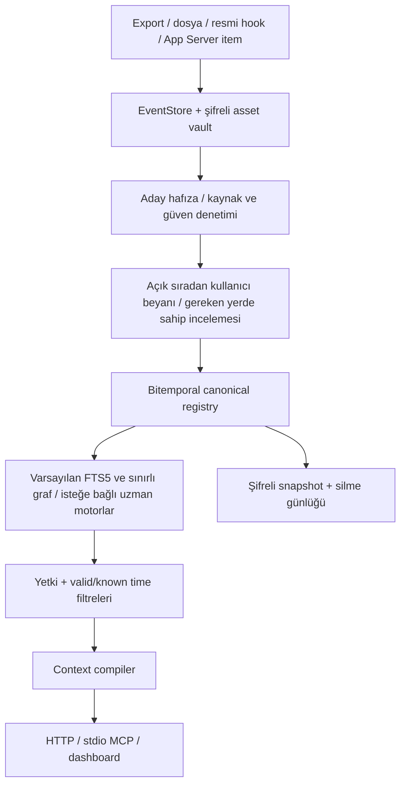

# Mimari

Güncel varsayılan: SQLite kaynak/iddia deposu → normalleştirilmiş özellik kimliği → FTS ve sınırlı graf projeksiyonu → bütçeli bağlam → dört MCP aracı. Her tur veri güncelliği kontrol edilir; eldeki paket aynıysa `known_state` ile kaynaklar tekrar taşınmaz. Aynı beyanın yeni kanıtı kopya sürüm üretmez; düzeltmelerde graf projeksiyonu geçerli sürümlere yönelir. Çekirdek açılışta opsiyonel sayısal/medya modüllerini yüklemez. [ADR 0006](docs/adr/0006-coherent-memory.md), [doğrulama raporu](reports/coherent-memory-20261028/REPORT.md).

28 Ekim 2026: [ADR 0005](docs/adr/0005-direct-user-statements.md) sıradan açık kullanıcı beyanlarını ikinci onay olmadan etkinleştirip aynı özellikte tek uygun güncel kaydı sürümlendirir. Kaynak/valid time/known time ve geçmiş korunur; genel approve yetkisi modele verilmez. Ek model veya yeni kanonik depo gerekmez.

27 Ekim 2026 erişim kararı: [ADR 0004](docs/adr/0004-evidence-before-expansion.md). Doğrudan kanıt graf gürültüsüne yer açmak için elenmez; graf yolu açıklanır; bağlam şeması 2 ihtilaf ve eksikliği görünür kılar. Desteklenen tek API sürecinde paket derleme, düzeltme/silme ile iç içe geçmez. Yeni model veya ikinci kanonik motor eklenmedi.

Öncelikli ürün kararı: **ortak kişisel bilgi veritabanı + ince MCP erişim katmanı**. Harita, kayıt kartı ve tam kaynak aralığı ayrı erişim düzeyleridir. Şema 6 artımlı `memory_routes`, `memory_sources`, `episode_index` ve `episode_fts` projeksiyonlarıyla konuşma kaynaklarını yaş filtresi olmadan erişilebilir kılar. Harita önbelleği izin, revizyon ve tarih sınırlarıyla geçersizleşir. [Ana sözleşme](MEMORY_DATABASE.md).

Ekonomik mod güncellemesi: mevcut konuşma modeli `brain.remember` ile kaynak alıntısı ve kısa adaylar gönderir. Varsayılan retrieval, tüm uygun kayıtları belleğe almak yerine FTS/kavram indeksinden başlayıp onaylı konu/varlık/açık bağlantı projeksiyonlarını sınırlı adımlarla izler. Şema 5, `topics`, `related_memory_ids`, `memory_nodes` ve `memory_links` içerir. [Akış ve sınırlar](ECONOMY_MODE.md).

Karar: bağımsız kanonik çekirdek + seçici uzman motorlar (araştırmadaki C+B). Tek kullanıcı için bir Python servisi ve bir SQLite dosyası; modüller bağımsız arayüzlere sahiptir. Gereksiz mikroservis veya ikinci bir kanonik veritabanı yoktur.

## Modül sınırları

| Modül | Sorumluluk |
|---|---|
| `models.py`, `db.py`, `migrations/` | Tipli sözleşmeler, kalıcı şema, atomik migration |
| `events.py`, `vault.py` | Kaynak olaylar, hash/idempotency, orijinal binary |
| `memory.py`, `entities.py` | Assertion, onay, sürüm, zamansal düzeltme, alias registry |
| `retrieval.py`, `providers.py` | ACL önce filtreleme, FTS/BM25/vector, bağlam bütçesi |
| `adapters.py`, `mem0_adapter.py` | Motor sözleşmesi, gerçek yerel Mem0 projection |
| `queue.py`, `importers.py`, `capture.py` | Dayanıklı ingestion, format/host adaptörleri |
| `learning.py`, `skills.py`, `tools.py` | Geri bildirim, prosedür adayları, paket ve yetenek envanteri |
| `multimodal.py`, `local_media.py` | Gerçek CPU OCR/ASR/video pipeline, kaynak bağlı aday ve checkpoint |
| `security.py`, `privacy.py`, `backup.py` | Yetki, quarantine, erasure closure, restore |
| `api.py`, `mcp_server.py`, `static/` | Yönetim ve model erişimi |
| `benchmark.py`, `tests/` | Sentetik değerlendirme ve regresyonlar |

## İşlem ve dayanıklılık

SQLite WAL, `BEGIN IMMEDIATE`, 30 saniye busy timeout ve süreç içi reentrant kilit kullanılır. API tek süreçte çalışır; MCP ve hook süreçleri veritabanını doğrudan açmak yerine bu API'yi kullanır. CLI sunucusu veri dizinine süreç kilidi alır. Çok worker ile çalıştırma desteklenmez.

Job ACK, sonuç kalıcı yazıldıktan sonra verilir. Süresi geçen lease yeniden alınabilir. Import tekrarlandığında kaynak içerik hash'i aynı olayı çoğaltmaz. Hata en çok dört denemeden sonra dead-letter durumuna geçer. Checkpoint tamamlanan asset ve adaptör sürümünü taşır.

Kanonik assertion'ların değişiklikleri bilinen-zaman sürümleriyle tutulur. Reindex yalnız türevleri yeniden kurar; bir hafıza motorunun düşmesi olay veya onaylı assertion kaybına yol açmaz. İşletim sistemi çökmesi/elektrik kesintisi ve çok makine senkronizasyonu için hata enjeksiyonu yapılmadı.

## Frontend kararı

FastAPI ile aynı origin'den sunulan modüler JavaScript/CSS seçildi. Node build sunucusu, CDN, dış font veya tarayıcıdan bulut API çağrısı gerekmez. API sözleşmeleri Pydantic/OpenAPI ile tiplenir; Python kodu mypy ile kontrol edilir. Frontend TypeScript değildir. Bu tercih kurulum ve çevrimdışı çalışmayı sadeleştirir; karmaşık istemci uygulamalarında TypeScript'e geçiş ayrı bir ADR gerektirir.
