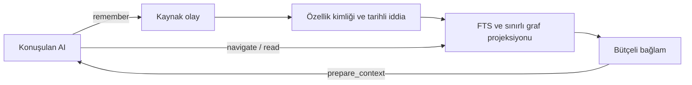

# Second Brain mimari düzenleme raporu

28 Ekim 2026. Sonuç: yerel ortak kişisel bilgi deposu hedefi korunarak çekirdek AI akışı sadeleştirildi. Ek model, paket bağımlılığı, mikroservis veya ikinci kanonik veritabanı eklenmedi. Çalışan yerel servis güncellendi ve mevcut veri şema 7'ye geçirildi.

## Son mimari

Kanonik kaynak ve iddialar SQLite'tadır. FTS, başlık rotaları ve graf bağlantıları yeniden üretilebilir erişim projeksiyonlarıdır. Aynı veri farklı motorlarda birbirinden bağımsız gerçekler olarak yönetilmez. Varsayılan model araçları yalnız `prepare_context`, `remember`, `navigate`, `read` olur. Yönetim ekranı korunur; eski araçlar `SB_MCP_PROFILE=full` ile açıkça seçilebilir. Okuma/kayıt token'ı genel onay, silme veya yönetim yetkisi kazanmaz.

## Değişen davranışlar

| Konu | Uygulanan davranış |
|---|---|
| Her tur güncellik | `prepare_context` çağrılır. Önceki tam paket hâlâ eldeyse aynı istekle `known_state` gönderilebilir; değişiklik yoksa küçük `unchanged` yanıtı gelir. |
| Farklı görev veya veri değişikliği | Sorgu, scope, bütçe, okuyucu, görünür revizyon veya ilgili zaman sınırı değişince taze paket hazırlanır. Restore, süreç başlangıcı ve indeks onarımı eski durumu geçersizleştirir. |
| Özelliklerin farklı yazımı | Ayrı `subject_key/predicate_key` indeksleri yazma ve okumada aynı kimliği kullanır. Dar kullanıcı özelliği alias'ları ve sahibin açık varlık alias'ları desteklenir; benzer isimlerden kişi birleştirilmez. Ham etiket/kaynaklar korunur. |
| Tekrar söylenen aynı bilgi | Birebir aynı değer yeni assertion sürümü oluşturmaz. Yeni kaynak, `statement_receipts` ile mevcut iddiaya bağlanır. Eski bir isteğin tekrarı sonraki düzeltmeyi geri almaz. |
| Bilginin değişmesi | Açık sıradan kullanıcı beyanı ikinci onay olmadan tek uygun güncel kaydı sürümlendirir. Önceki değer geçmişte kalır; belirsiz/korunan değişiklikler incelemede kalır. |
| Düzeltme sonrası bağlantılar | Projeksiyon geçerli sürüm ailesine yönelir. Orijinal dayanak kimliği korunur. Bağımlı kayıtta `related_version_changed` ve ayrıntıda `related_current_refs` görünür; sonuç metni kendiliğinden değiştirilmez. |
| Skill/tool erişimi | Başlıklardan yalnız gereken metadata ve dosya açılır; skill destek dosyası `read(kind=skill,id,path)` ile alınır. Ek araç veya çalıştırma yetkisi gerekmez. |
| Silme ve kurtarma | Tekrar kanıtı/alias ilişkileri export, silme kapanımı, yedek ve yeniden indeksleme zincirine dahil edildi. |
| Hafif çekirdek | NumPy/BM25/medya modülleri ihtiyaç olduğunda yüklenir. Varsayılan ekonomi akışı embedding/üretken model çağırmaz. |

## Araştırmanın projeye karşılığı

[Önceki araştırma raporundaki](../research-20261026/SECOND_BRAIN_ARASTIRMA_RAPORU.md) mevcut AI'nın bilgiyi seçmesi, kanıt ile iddiayı ayırma, genelden özele erişim ve ham kaynağı koruma ilkeleri kullanıldı. memU, Titen, OpenViking/BasicMemory ve MemPalace gibi projeler tasarım referansıdır; bu tur bunların paketleri veya kodları projeye eklenmedi. Mevcut SQLite, kaynak/iddia ve MCP katmanları bu ihtiyaçları karşılayacak şekilde birleştirildi. Gereksiz bağımlılık ve ikinci veri yönetimi yükü oluşturulmadı.

## Doğrulama

`scripts/Verify.ps1` tamamlandı: **203 test geçti**, Ruff lint/format, mypy, JavaScript sözdizimi ve kaynak secret taraması geçti. Kaynak taraması 0 bulgu verdi. [JUnit](tests.xml), [tarama sonucu](secret-scan.json). Opsiyonel Mem0/Qdrant testinde yerel Qdrant payload indeksleri hakkında upstream uyarı çıktı; başarısız test yok.

32 yeni vaka, koşullu bağlamın tam aramaya girmemesini, istek/okuyucu/tenant/scope/hassasiyet izolasyonunu, gelecekteki zaman geçişini, restore ve reindex durumunu, özellik/alias çakışmasını, tekrar kanıtının silinmesini, düzeltme sonrası bağlantıları, skill dosyasını, eski config uyumluluğunu ve hafif açılışı kapsar. Gerçek SDK stdio + HTTP testi hem dört araçlı profili hem full profili sınar.

Gerçek kısıtlı istemciyle salt okunur kontrolde dört araç ve yeni şema alanları görüldü; aynı bağlam için `unchanged` döndü; izin verilmeyen scope reddedildi. Mevcut güncel kişisel bilgi erişilebilir kaldı. [Canlı bağlantı sonucu](live-connection.json). Bu kontrol kişisel kaynak metnini rapora kopyalamadı, sentetik kayıt yazmadı. Host yapılandırmasındaki eski allowlist, yeni sunucunun dört araçlık kataloğuyla uyumludur; kullanıcı yapılandırması değiştirilmedi. Açık host oturumlarının yeni araç/talimat kataloğunu alması için MCP yeniden bağlanması gerekebilir.

Servis güncellenirken şema **6 → 7** yükseltildi. Öncesi ve sonrası 4 kaynak olayının ve 4 iddianın ham alan SHA-256 özetleri birebir eşleşti. Yalnız türetilmiş anahtar/projeksiyonlar eklendi. [Önce](migration-before.json), [sonra](migration-after.json). Bu sayılar geçiş anının kaydıdır; sonradan normal konuşma kaydı eklenebilir.

## Maliyet ve performans ölçümü

5.001 sentetik kayıt; aynı süreçte, aynı sorguda, 30 sıcak çalıştırma:

| Ölçüm | Taze bağlam | Değişmemiş bağlam kontrolü |
|---|---:|---:|
| Yerel süre medyanı | 73,455 ms | 4,013 ms |
| Yerel süre p95 | 75,695 ms | 4,924 ms |
| Serileştirilmiş yanıt | 2.856 bayt | 188 bayt |

Değişmemiş akışta tam arama çağrısı 0; ek embedding/üretken model çağrısı 0. [Ölçüm JSON](performance.json), tekrar üretim: `scripts/evaluate_coherent_memory.py`. Koşullu kontrolde SQLite metadata indekslerine yine bakılır; bu sıfır işlem maliyeti demek değildir. Önceki paketin bağlamda bulunması gerekir.

Aynı sürüm MCP kataloğu: çekirdek **4 araç / 7.861 bayt**, full **19 araç / 16.924 bayt**. Sunucu talimatı 2.900 bayt. Katalog baytları sağlayıcının her tur aynı tutarda faturalayacağı anlamına gelmez. Sağlayıcı tokenizer'ı, araç protokolü ve önbellekleme politikasına göre gerçek token/fatura değişir.

## Açık sınırlar

Bu yapı Kruskal veya sinir ağı kullanmaz; anahtar/FTS araması ve sınırlı graf gezinmesi kullanır. Genel doğal dil eşdeğerliği, eksiksiz bir yıllık hatırlama ve modelin her talimata uyması kanıtlanmış değildir. Bağlantı kurulmamış AI platformunun sohbeti otomatik kaydedilmez. Yalnız yakalanmış bilgi bulunabilir; ihtilaf/eksiklik bayrakları dikkate alınmalıdır. Bilinmeyen alias'lar ve bağımlı kararların yeniden değerlendirilmesi AI/sahip incelemesi gerektirebilir.

Mimari karar: [ADR 0006](../../docs/adr/0006-coherent-memory.md). Güncel kullanım: [MCP sözleşmesi](../../MCP_REFERENCE.md), [veritabanı davranışı](../../MEMORY_DATABASE.md).
